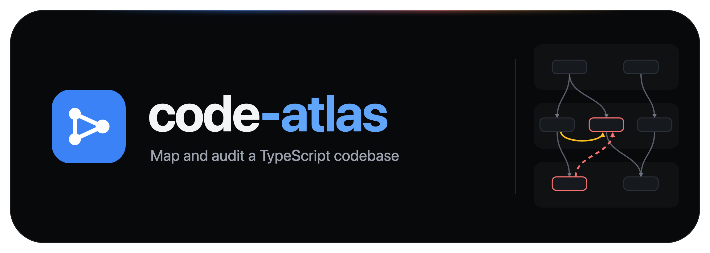
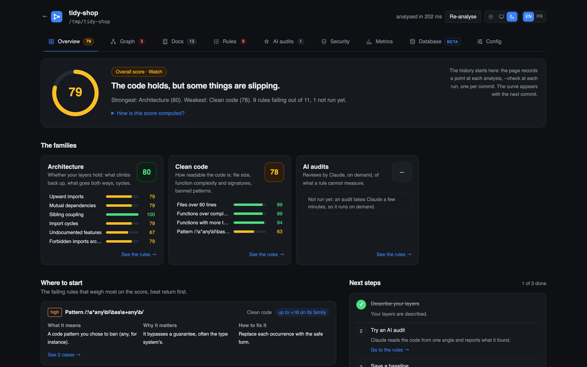
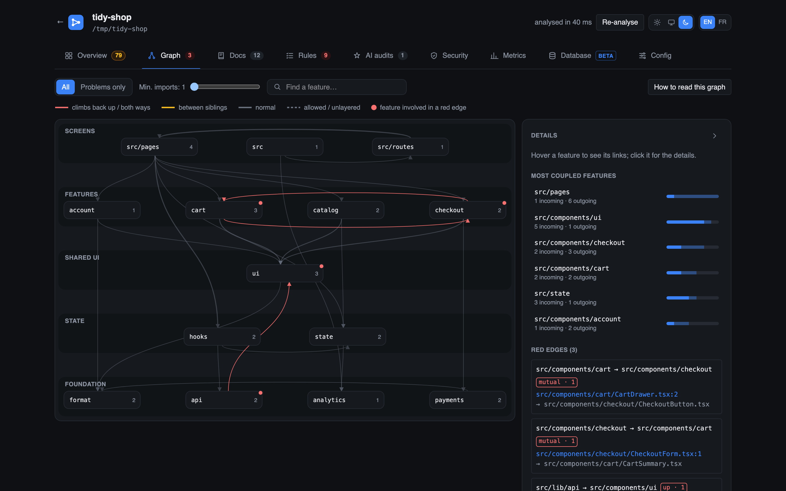
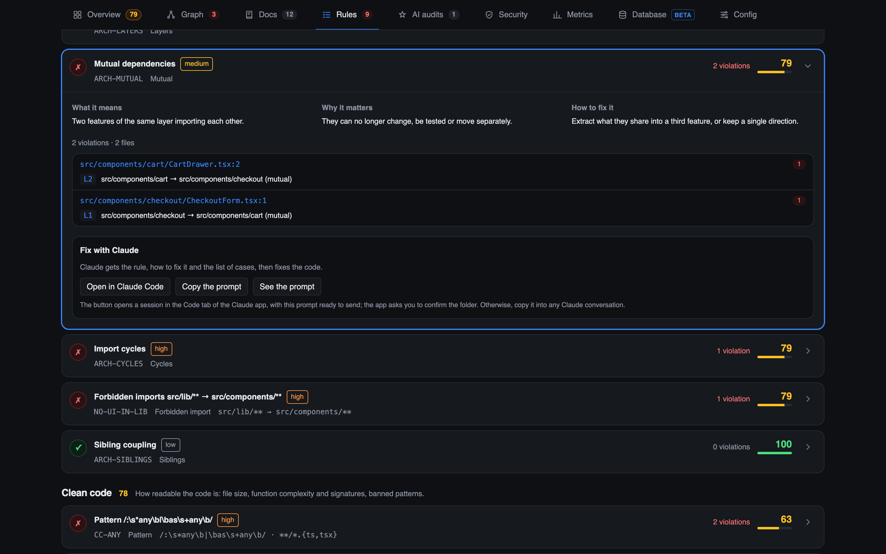
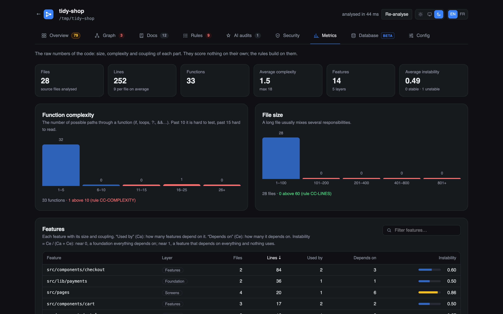

<div align="center">



**Map and audit a TypeScript codebase.**

The feature dependency graph across your layers, the metrics behind it, scripted and AI audit
rules, a score per family and per package of a monorepo, the Drizzle schema beside the code — and
a CI guard that fails only when something got worse.

[](https://www.npmjs.com/package/@vincweb/code-atlas)
[](https://github.com/Vincweb/code-atlas/releases/latest)
[](https://github.com/Vincweb/code-atlas/actions/workflows/ci.yml)
[](package.json)
[](package.json)
[](LICENSE)

</div>

<br>

<div align="center">

</div>

<br>

```sh
npx @vincweb/code-atlas            # open the page on the current project
npx @vincweb/code-atlas --check    # fail CI on any regression against the baseline
```

## Why

Lint guards a line. Nothing guards the shape: which feature imports which, whether the layers you
drew on a whiteboard still hold, which corner of the code grows tangled. code-atlas reads the import
graph with your project's own TypeScript, groups files into features, places them in your layers,
and paints every dependency that climbs back up a layer or goes both ways between two features.

## Install

```sh
npx @vincweb/code-atlas               # run it once
npm install -D @vincweb/code-atlas    # or keep it in the project, for CI
```

Installed, the command is `code-atlas`. It serves `http://127.0.0.1:4800` and opens it in your browser — on the current folder when it is a
project, otherwise on a welcome screen with your recent projects and a folder browser. Node 20 or
newer and no runtime dependencies: it uses the `typescript` package the analyzed project already
has (TypeScript 7 ships no compiler API). Nothing leaves the machine, except what an AI rule sends
to Claude when you run one.

| Option              | Default                  | What it does                                      |
| ------------------- | ------------------------ | ------------------------------------------------- |
| `--root <dir>`      | the current folder       | the project to open                               |
| `--config <file>`   | `<root>/code-atlas.json` | another config file                               |
| `--state <dir>`     | `<root>/.code-atlas`     | where the baseline and the runs are kept          |
| `--port <n>`        | `4800`                   | the page's port                                   |
| `--host <host>`     | `127.0.0.1`              | the interface to listen on                        |
| `--no-open`         |                          | do not open the browser                           |
| `--check`           |                          | compare with the baseline, exit 1 on a regression |
| `--update-baseline` |                          | record the current state as the baseline          |
| `--skip-commands`   |                          | with the two above, leave the `command` rules out |

## The page

<div align="center">

</div>

- **Overview** — the overall score and its curve over the last commits, a score per family
  (architecture, clean code, tooling, database, AI audits), the failing rules that weigh most, the
  packages of a monorepo worst first, and the next steps.
- **Graph** — one band per layer, top to bottom. Red for a dependency that climbs a layer or goes
  both ways, amber for coupling between sibling features. Click a feature for its files, its
  coupling, and the import statements behind each red edge.
- **Rules** — every rule with its violations at `file:line`, what it means, why it matters and how
  to fix it. Command and AI rules run from here, their output streamed live.
- **AI audits** — what an AI rule does and the prompt it sends, a gallery of ready-made audits, and
  the findings of each run.
- **Security** — runs [Strix](https://github.com/usestrix/strix), an open-source AI pentester, on
  a copy of the project and shows its findings, and checks whether Strix is wired into the CI.
- **Metrics** — complexity and file-size distributions, each feature's size and instability, the
  most complex functions and the largest files.
- **Database** (beta) — when the project has a `drizzle.config.*`: the schema as a diagram, one
  feature at a time; the feature graph of the database, where an edge is a foreign key and a
  junction table is the accepted way for two features to meet; and the migration DAG, drawn by
  [drizzle-graph](https://github.com/Vincweb/drizzle-graph).
- **Config** — the effective config explained section by section, or a draft to start from.

<div align="center">

</div>

<br>

<div align="center">

</div>

## Config

`code-atlas.json` at the project root. Without one, defaults apply and the Config tab drafts one
from the graph — layers by dependency depth — to write into the project and correct.

```json
{
  "$schema": "https://raw.githubusercontent.com/Vincweb/code-atlas/main/schema.json",
  "features": ["src/components/*", "src/lib/*", "src/*"],
  "layers": [
    { "name": "Entry", "features": ["src", "src/pages"] },
    { "name": "Features", "siblings": true, "features": ["src/components/*"] },
    { "name": "Core", "features": ["src/lib", "src/lib/*"] }
  ],
  "allow": [["src/lib/api", "src/lib/http"]],
  "rules": [
    { "id": "ARCH-LAYERS", "family": "architecture", "severity": "high", "kind": "layers" },
    {
      "id": "CC-COMPLEXITY",
      "family": "clean-code",
      "severity": "medium",
      "kind": "complexity",
      "max": 15
    },
    {
      "id": "TL-LINT",
      "family": "tooling",
      "severity": "high",
      "kind": "command",
      "run": "pnpm lint"
    },
    {
      "id": "AI-NAMING",
      "family": "ai",
      "severity": "medium",
      "kind": "ai",
      "prompt": "Review naming…"
    }
  ]
}
```

- **features** — ordered patterns; `*` binds one directory, first match wins.
- **layers** — top to bottom. A dependency may only go down; `siblings` forbids coupling inside one.
- **rules** — static kinds (`layers`, `mutual`, `siblings`, `no-cycle`, `forbid-import`,
  `max-lines`, `complexity`, `max-params`, `pattern`, `db-layers`, `db-mutual`, `db-siblings`) are
  computed on every analysis; `command` and `ai` rules run on a click or under `--check`.

- **workspaces** — the package folders of a monorepo; read from `pnpm-workspace.yaml` or the
  `workspaces` of `package.json` when left out, `[]` to analyze the root as one project.
- **database** — which Drizzle config to read, how tables group into features, their layers and
  junction tables; see [Database (beta)](#database-beta) below.

A rule scores `100 × 0.5^(violations / halfLife)`, its weight set by its severity; a family is the
weighted mean of its rules, the overall score the mean of the families.
[examples/tidy-shop](examples/tidy-shop) is a small fictitious project with a full config — the one
in the screenshots.

## Monorepos

Open the root of a pnpm, npm or yarn workspace and code-atlas finds its packages — every folder the
workspace names that holds a `package.json` and a `tsconfig.json` — and reads them in one pass, each
file with its own package's tsconfig. An import of `@acme/ui` through `node_modules` becomes an edge
to the package's sources, so the graph shows which package uses which.

- **A score per package.** Each violation counts against the package of its file, and each package
  is scored on its own violations, as if analyzed alone. The Overview lists the packages worst
  first; the package picker scopes every tab — overview, graph, rules, metrics — to one of them.
- **A score for the repository** — each rule's score is the mean of its packages', weighted by their
  lines: ten packages with three violations each score like one package with three, not like one
  with thirty.
- **The graph of packages.** The whole view draws one node per package, red when two packages
  import each other; open a package for its own features and layers.
- **Commands.** A `command` rule runs at the root (`pnpm lint`, through turbo or `pnpm -r`): the
  paths a task prints are read relative to the package its `<package>:<task>:` prefix names.
- **`--check`** fails when the repository or any single package has more violations than in the
  baseline, which records both.

Default `include` and `features` apply inside each package (`apps/*/src/**`, `apps/web/src/*`), and
feature ids keep the full path, so layers and rules can name one package or all of them:
`"apps/*/src/views"`.

## Database (beta)

With a `drizzle.config.*` under the project — or under its workspace, for a package that uses a
sibling's schema — code-atlas reads the schema the config names, as source: the config is never
executed and nothing connects to a database. Tables group into features by the first word of
their name (`customers`, `customer_calls` and `customers_projects` land together), or as
`database.features` says; `database.layers` works like `layers`. The three `db-*` rules mirror
`layers`, `mutual` and `siblings` over foreign keys, with one exception: a foreign key held by a
junction table — two keys to distinct tables under one composite primary key — never nests two
features. A 1:N key from a feature to the layer below is normal; a direct key between siblings,
or in both directions, is not.

```json
{
  "database": {
    "config": "packages/db/drizzle.config.ts",
    "features": [
      { "name": "customer", "tables": ["customer_*", "customers", "customers_*"] },
      { "name": "catalog", "tables": ["products", "backoffice.*"] }
    ],
    "layers": [
      { "name": "Features", "siblings": true, "features": ["customer", "sell_in"] },
      { "name": "Reference", "features": ["catalog", "users"] }
    ],
    "junctions": ["customer_product_prices"]
  }
}
```

The database family scores on the page but counts neither in the overall score nor in `--check`
while the tab is in beta. The migrations view needs the Drizzle Kit v1 layout, one folder per
migration with its `snapshot.json`.

## AI rules

An `ai` rule runs Claude Code headless (`claude -p`) in the project, read-only (`Read`, `Grep`,
`Glob`), until Claude is done, and gets its findings back as structured data. It uses your own
Claude Code login, or `ANTHROPIC_API_KEY` when it is set: code-atlas never handles a key, and sets
no spending cap — it is your login and your plan. Results are kept per rule, with what the run
cost, and marked stale when the commit moves. They never gate `--check`: two runs on the same
commit can disagree.

## Security tests

The Security tab runs [Strix](https://github.com/usestrix/strix) headless on a copy of the project:
what git tracks or would track, without ignored files, symbolic links or `node_modules`, since
Strix mounts its target writable. Its agents run in Docker and use the model in `STRIX_LLM` with
`LLM_API_KEY` (or `~/.strix/cli-config.json`) from the environment code-atlas was started in; the
code goes to that provider. Strix's telemetry is off unless `STRIX_TELEMETRY` says otherwise.

```sh
curl -sSL https://strix.ai/install | bash   # Strix itself, and Docker running
```

Pick a mode — quick, standard or deep — and a spending cap. The scan carries on when you leave the
page and stops with code-atlas. Each finding comes with its severity, CVSS and CWE, its place in the
code, its proof of concept and a button to hand the fix to Claude Code. Reports land in
`.code-atlas/runs/strix_runs/`, under the folder you already ignore. The tab also checks whether a
CI job runs Strix — headless, scan mode, failing severity, secrets — whether its skills are
installed for coding agents, and whether git ignores the reports. A scan counts in no score and
never in `--check`: two runs on one commit find different things.

## Working with Claude Code

```sh
npx @vincweb/code-atlas describe
```

prints the config format and the project's current state — features, layers, red edges with the
imports behind them, rules, scores, the recent history — written for an AI assistant. The page's
"Open in Claude Code" buttons open a new session in the Code tab of the Claude desktop app, on the
project, with a prompt that runs it before editing `code-atlas.json` or fixing a rule, and again to
check the result; the prompt is filled in, never sent. "Copy the prompt" does the same for any
other assistant.

### As an MCP server

```sh
claude mcp add -s project code-atlas -- npx -y @vincweb/code-atlas mcp
```

writes `.mcp.json` at the project root — commit it, and every Claude Code session on the project
gets the tools below. `npx -y @vincweb/code-atlas` runs the version the project installed when it
has one. The file is the generic form, for any MCP client that starts servers over stdio:

```json
{
  "mcpServers": {
    "code-atlas": { "command": "npx", "args": ["-y", "@vincweb/code-atlas", "mcp"] }
  }
}
```

For yourself, on every project, `-s user` instead of `-s project`. Without `-s`, Claude Code
keeps it for you and this folder only. The server starts where Claude Code runs, so start Claude
Code at the project root; `--root` names another project, and each tool also takes a `root`.
`claude mcp list` tells whether it connects.

`code-atlas mcp` speaks the Model Context Protocol on stdio — no dependency, the protocol is a few
JSON lines. The tools:

| Tool         | What it answers                                                                                                                      |
| ------------ | ------------------------------------------------------------------------------------------------------------------------------------ |
| `overview`   | the scores per family, every rule with its count, the packages of a monorepo, the recent history                                     |
| `violations` | the violations at `file:line`, filtered by rule or file glob, capped with the total                                                  |
| `edges`      | the dependencies between features with the imports behind each — the red ones by default — or the foreign keys of the database graph |
| `feature`    | one feature: its layer, files, coupling, edges in and out                                                                            |
| `check`      | the ratchet against the baseline, as `--check` does; `commands: true` runs the command rules too                                     |
| `config`     | the format of `code-atlas.json` and the effective config, to read before editing it                                                  |
| `describe`   | what `code-atlas describe` prints                                                                                                    |

Every tool analyses the project afresh, so a call takes what an analysis takes: a few seconds on
a large project. In a monorepo, `package` scopes `overview`, `violations` and `edges` to one package.

## CI

```sh
npx @vincweb/code-atlas --update-baseline   # once, and whenever you accept the current state
npx @vincweb/code-atlas --check             # fails when any rule has more violations than the baseline
```

The baseline lives in `.code-atlas/baseline.json` — commit it. Runs land in `.code-atlas/runs/`:
ignore that folder.

`--format` picks what `--check` prints, for the machine reading it:

| Format   | What it prints                                                                                                                                                             |
| -------- | -------------------------------------------------------------------------------------------------------------------------------------------------------------------------- |
| `text`   | the report above, the default                                                                                                                                              |
| `json`   | one document on stdout — scores, rules with their violations, packages, regressions — the report on stderr                                                                 |
| `github` | the report, plus one error annotation per regressed rule and one on each of its violations (ten at most, the runner's limit), and a table of the scores in the job summary |
| `sarif`  | SARIF 2.1.0 on stdout, every violation of every rule that ran, for code scanning                                                                                           |

```yaml
- run: npx @vincweb/code-atlas --check --format github
```

shows a regression inline in the pull request, on the lines of its new violations. For every
violation — new or old — as a code scanning alert, with the new ones flagged on the pull request by
GitHub itself, upload the SARIF:

```yaml
- run: npx @vincweb/code-atlas --check --format sarif > code-atlas.sarif
  continue-on-error: true
- uses: github/codeql-action/upload-sarif@v3
  with:
    sarif_file: code-atlas.sarif
```

Paths in both are relative to `GITHUB_WORKSPACE`, so `--root apps/web` still lands on the right
file.

### History

Every analysis the page makes, and every `--check`, records the scores of the commit in
`.code-atlas/runs/history.jsonl` — one line per commit, the latest state of it. The Overview draws
the curve of the overall score over the last commits, `describe` prints it, and the `overview` MCP
tool returns it. The file lives under `runs/`, so it stays per machine: in CI it is written and
forgotten, on your machine it is the history of your work on the project.

## Security

A `code-atlas.json` names commands to run, like a `package.json` names scripts: only open projects
you trust. Nothing runs when a page opens; running is a click, refused to any other origin. The
server answers only to `localhost` unless `--host` exposes it, and the page reads no dotfile,
nothing in `node_modules` and nothing outside the project — not even through a symlink.

## Development

```sh
pnpm install
pnpm dev --root ../some-project   # API on :4800 with reload, page on :4801
pnpm check                        # lint, types, tests, build
node scripts/readme-images.mjs    # regenerate docs/media from examples/tidy-shop (needs Chrome)
```

[docs/design.md](docs/design.md) records the decisions and the alternatives they beat. The only
bundled package is [drizzle-graph](https://github.com/Vincweb/drizzle-graph), a dev dependency
tsup inlines, so the published package still has no runtime dependency.

## License

MIT
